<picture>
  <source media="(prefers-color-scheme: dark)" srcset="docs/assets/liaison-brand-rays-dark.svg" />
  
</picture>

> **Selbst gehosteter Zugriff auf private Apps, LLMs und KI-Agenten.**

Browser-Arbeitsbereiche, API-Freigaben mit begrenztem Berechtigungsumfang und kontextbezogene KI-Unterstützung – über Konnektoren, die ausschließlich ausgehende Verbindungen aus dem privaten Netz aufbauen.

[](https://github.com/liaisonio/liaison/actions/workflows/go.yml)
[](https://github.com/liaisonio/liaison/releases)
[](https://github.com/liaisonio/liaison/releases)
[](go.mod)
[](web/package.json)
[](web/package.json)
[](web/vite.config.ts)
[](web/tailwind.config.cjs)
[](#contributing)

[English](./README.md) | [简体中文](./README_zh.md) | [日本語](./README_ja.md) | [한국어](./README_ko.md) | [Español](./README_es.md) | [Français](./README_fr.md) | Deutsch

[Website](https://liaison.cloud) · [Dokumentation](https://liaison.cloud/docs/get-started/introduction) · [Funktionen](#features) · [Installation](#install) · [Zugriffsprotokolle](#supported-access-protocols) · [Agent-Modelle](#agent-model-providers) · [Produktrundgang](#product-tour)

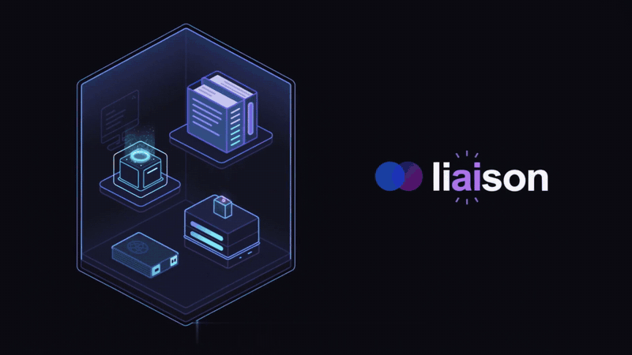

<a id="features"></a>

## Funktionen

- 🤖 **Zugriff auf lokale LLMs** — Lokale Modelle über authentifizierte APIs und einen Playground im Browser teilen.
- 🔑 **Kontrollierte API-Freigaben** — Schlüssel auf Modelle beschränken, Token-Kontingente festlegen, Zugriff widerrufen und Nutzung verfolgen.
- 🤖 **Zugriff auf KI-Agenten** — Codex und Claude Code auf deinen Geräten im Browser nutzen – mit fortsetzbaren Sitzungen, Ausführungsfortschritt und Berechtigungsabfragen.
- 💻 **Browser-IDE** — Projekte mit code-server bearbeiten sowie Terminals und Erweiterungen nutzen.
- ✨ **KI im Arbeitsablauf** — Terminalausgaben prüfen, Befehle entwerfen und Datenbanken innerhalb der Benutzerberechtigungen abfragen; erforderliche Freigaben werden vorher eingeholt.
- 💬 **Ressourcen abfragen** — Konnektoren, Geräte und Anwendungen innerhalb deines Zugriffsbereichs finden.
- 🔌 **Nur ausgehende Verbindungen** — Private Geräte anbinden, ohne darauf eingehende Ports zu öffnen.
- 🔐 **Anwendungszugriff** — TCP-, HTTP-, HTTPS-, WebSocket- und SSH-Dienste mit individuellen Zugriffskontrollen nutzen.
- 🖥️ **Browser-Arbeitsbereiche** — Terminals, Remote-Desktops, Datenbanken und Caches im Browser verwenden.
- 📁 **Dateien und Objekte** — Dateien per SFTP verwalten und S3-kompatiblen Speicher durchsuchen (nur lesend).
- 🔎 **Anwendungserkennung** — Vorhandene Dienste auf Konnektor-Geräten erkennen und über die Konsole registrieren.
- 👥 **Identitäts- und Zugriffsverwaltung** — Benutzer und Ressourcen mit Casbin-basierter Autorisierung verwalten.
- 🛡️ **Firewall-Regeln** — TCP- und HTTP-Zugriffe anhand der Quell-IP oder eines CIDR-Bereichs einschränken.
- 📋 **Protokolle und Audit** — Verwaltungsaktionen und unterstützte Anwendungssitzungen prüfen.
- 📦 **Selbst gehosteter Betrieb** — Die vollständige Steuerungsebene auf dem eigenen Linux-Server betreiben.

<a id="install"></a>

## Installation

Lade das eigenständige Docker-Paket herunter, entpacke es und starte das Installationsprogramm (Docker 20.10 oder neuer mit Compose erforderlich):

```bash
wget https://github.com/liaisonio/liaison/releases/download/v1.15.4/liaison-1.15.4-linux-amd64.tar.gz
tar -xzf liaison-1.15.4-linux-amd64.tar.gz
cd liaison-1.15.4-linux-amd64
./install.sh
```

Öffne nach der Installation `https://<server-address>`. Das Installationsprogramm gibt die anfänglichen Anmeldedaten aus.

<a id="supported-access-protocols"></a>

## Unterstützte Zugriffsprotokolle

Greife mit Liaison auf deine vorhandenen privaten Dienste zu.

<table>
  <tr><th align="left">SSH / SFTP</th><td>&nbsp;&nbsp; </td></tr>
  <tr><th align="left">Desktop</th><td>&nbsp;&nbsp; 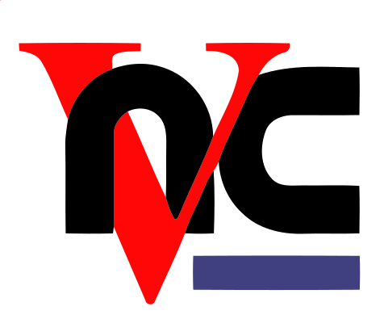</td></tr>
  <tr><th align="left">SQL-Datenbanken</th><td>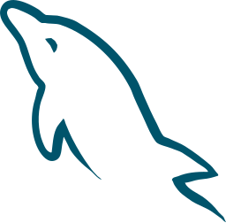&nbsp;&nbsp; &nbsp;&nbsp; &nbsp;&nbsp; &nbsp;&nbsp; 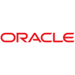&nbsp;&nbsp; </td></tr>
  <tr><th align="left">Daten und Suche</th><td>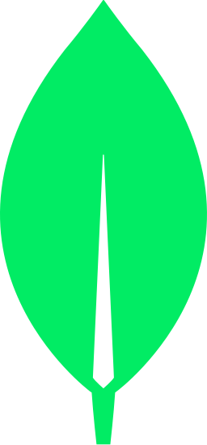&nbsp;&nbsp; &nbsp;&nbsp; </td></tr>
  <tr><th align="left">Cache</th><td>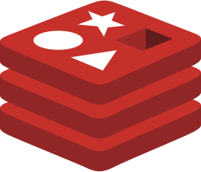&nbsp;&nbsp; </td></tr>
  <tr><th align="left">Speicher</th><td></td></tr>
  <tr><th align="left">LLM-Upstream-Protokolle</th><td><picture><source media="(prefers-color-scheme: dark)" srcset="docs/assets/integrations/readme/openai-dark.svg" /></picture>&nbsp;&nbsp; &nbsp;&nbsp; <picture><source media="(prefers-color-scheme: dark)" srcset="docs/assets/integrations/readme/ollama-dark.svg" /></picture></td></tr>
  <tr><th align="left">Web / TCP</th><td>&nbsp;&nbsp; </td></tr>
</table>

LLM-Upstreams unterstützen **OpenAI-compatible**, **Anthropic Messages** und **Ollama**. Clients verwenden OpenAI-compatible-Endpunkte; für Anthropic-Upstreams stehen zusätzlich native Messages-Endpunkte bereit. Die Logos kennzeichnen vorhandene, zugängliche Dienste, nicht von Liaison mitgelieferte oder bereitgestellte Produkte. Datenbank- und Desktop-Logos stehen für Browser-Arbeitsbereiche, nicht für native Datenbank-, RDP- oder VNC-Server, die Verbindungen annehmen.

<a id="agent-model-providers"></a>

## Modellanbieter für den Agent

Das Modell des integrierten Liaison-Agent lässt sich unabhängig vom Dienstzugriff konfigurieren.

<table>
  <tr>
    <th align="left">Modelle</th>
    <td><picture><source media="(prefers-color-scheme: dark)" srcset="docs/assets/integrations/readme/openai-dark.svg" /></picture>&nbsp;&nbsp; &nbsp;&nbsp; &nbsp;&nbsp; &nbsp;&nbsp; <picture><source media="(prefers-color-scheme: dark)" srcset="docs/assets/integrations/readme/zhipu-dark.svg" /></picture>&nbsp;&nbsp; <picture><source media="(prefers-color-scheme: dark)" srcset="docs/assets/integrations/readme/kimi-dark.svg" /></picture>&nbsp;&nbsp; &nbsp;&nbsp; <picture><source media="(prefers-color-scheme: dark)" srcset="docs/assets/integrations/readme/mimo-dark.svg" /></picture></td>
  </tr>
</table>

Acht vorkonfigurierte Anbieter sowie benutzerdefinierte OpenAI-compatible-Dienste.

<a id="product-tour"></a>

## Produktrundgang

### Zugriff auf lokale LLMs

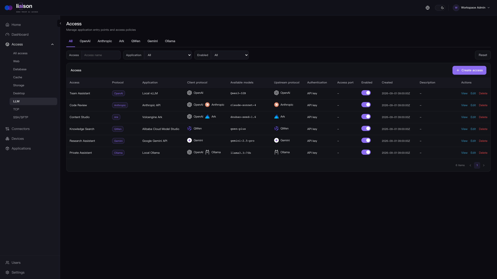

### Web SSH

Arbeite in einem Browser-Terminal mit Audit-Funktion. Der Agent kann Sitzungsausgaben prüfen und beim Entwerfen von Befehlen helfen.

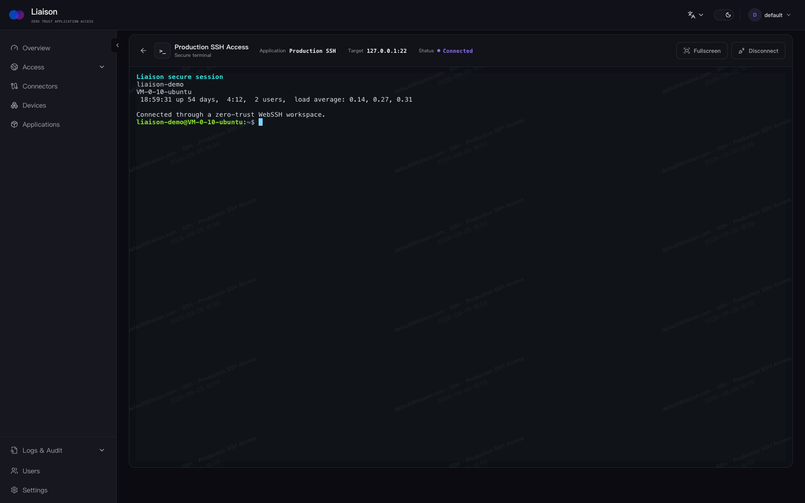

### Private Webanwendungen

Greife über Liaison auf Medienserver und andere interne Webanwendungen zu.

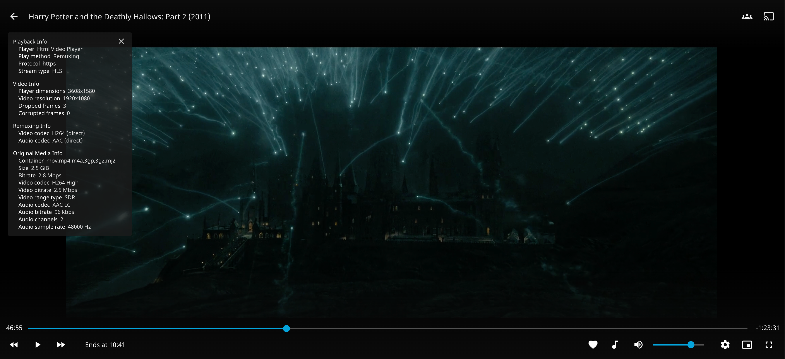

### Private KI-Assistenten

Nutze interne KI-Werkzeuge, ohne das private Netzwerk offenzulegen.

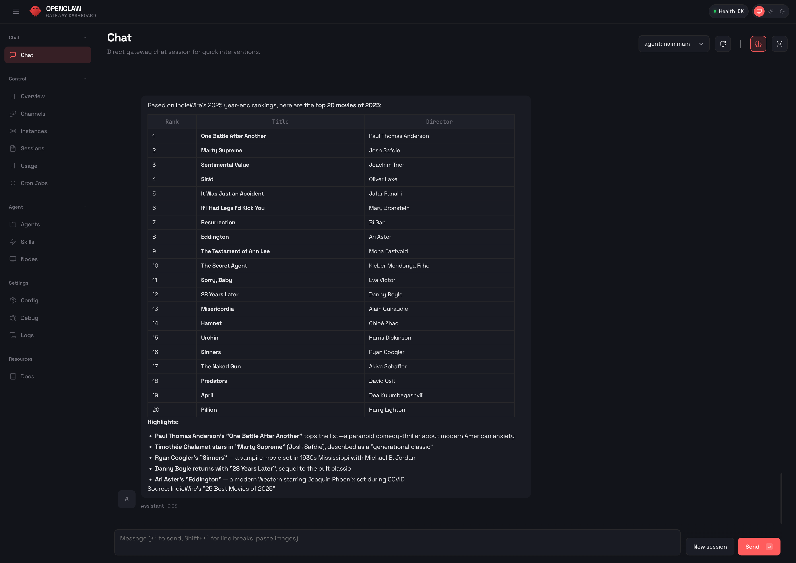

### Web MySQL

Durchsuche Schemas, führe SQL aus und bitte den Sitzungs-Agent um Abfragen und Erläuterungen der Ergebnisse – mit Freigabe, wo erforderlich.

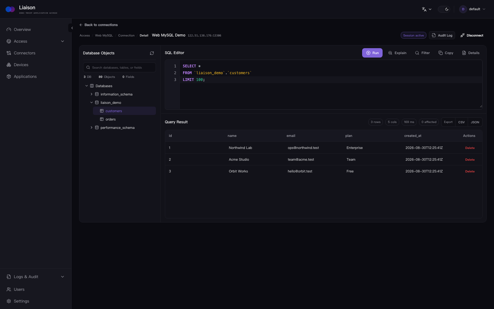

### Web MongoDB

Durchsuche Collections und lass den Agent genehmigte Abfragen ausführen und Dokumente erklären, ohne lokalen Client.

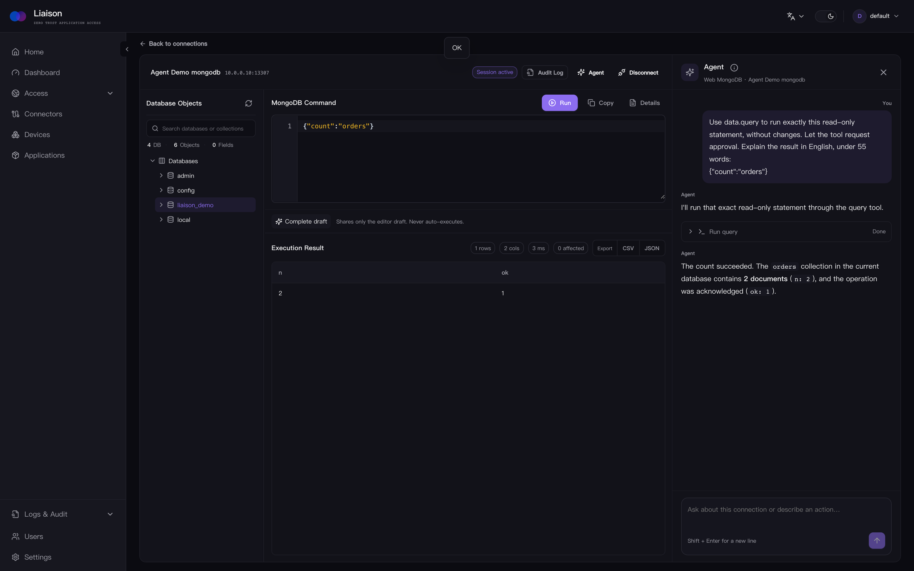

### Web VNC

Öffne einen privaten VNC-Desktop in einer verwalteten Browser-Sitzung.

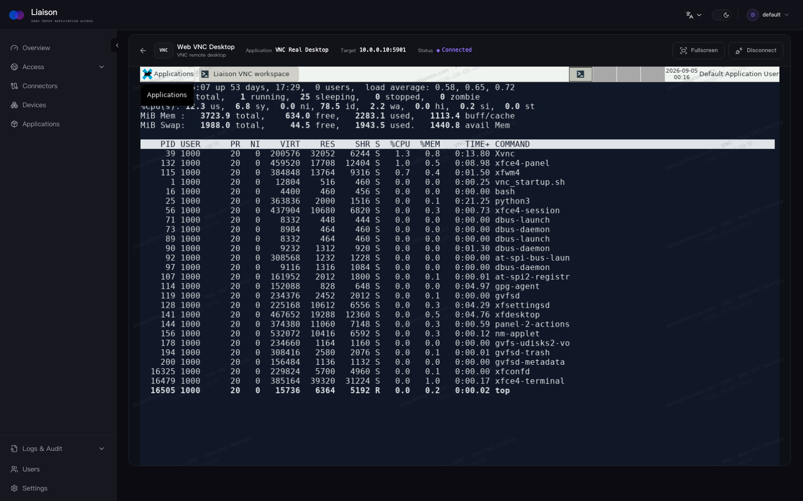

### Web RDP

Verbinde dich über denselben Zugriffsablauf mit einem RDP-Desktop.

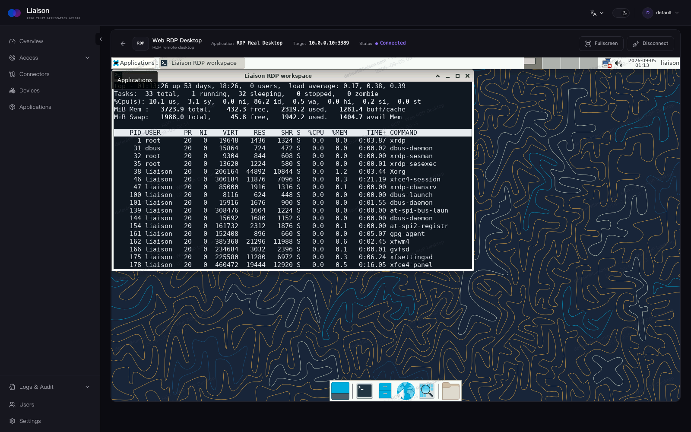

<a id="documentation"></a>

## Dokumentation

- [Docker-Bereitstellung](deploy/docker/README.md)
- [API-Referenz](docs/swagger/swagger.yaml)
- [Versionshinweise](https://github.com/liaisonio/liaison/releases)
- [Issues](https://github.com/liaisonio/liaison/issues)
- [Diskussionen](https://github.com/liaisonio/liaison/discussions)

<a id="contributing"></a>

## Mitwirken

Liaison wird kontinuierlich weiterentwickelt. Beiträge zur selbst gehosteten Edition in diesem Repository sind willkommen.

- KI-Agenten: Integrationen, Sitzungsverwaltung und Zusammenarbeit.
- Anwendungszugriff: SSH, Dateien, Datenbanken, IDEs, Remote-Desktops und Modell-APIs.
- Plattformunterstützung: Installation und Kompatibilität unter Linux, macOS und Windows.
- Benutzerfreundlichkeit: Verbesserungen der Oberfläche, Übersetzungen und Dokumentation.

Besprich größere Änderungen zuerst in einem Issue. Beschränke jeden PR auf ein Thema und beschreibe die durchgeführten Prüfungen. Füge keine Zugangsdaten, privaten Daten oder umgebungsspezifischen Deployment-Details hinzu. Die Mitarbeit ist vollständig auf GitHub möglich; die Teilnahme an einer Chatgruppe ist freiwillig.

Fehlermeldungen, Funktionsvorschläge, Verbesserungen der Dokumentation und Pull Requests sind willkommen. Starte unter [Issues](https://github.com/liaisonio/liaison/issues) oder erstelle einen [Pull Request](https://github.com/liaisonio/liaison/pulls).

<a id="license"></a>

## Lizenz

Liaison steht unter der [GNU Affero General Public License v3.0](LICENSE).
